# Race Check-in Kiosk

A self-hosted check-in system for running events. Participants collect their start number at a tablet by scanning the QR code from their confirmation e-mail, or by entering a PIN. Every check-in is written straight back to the Google Sheet the organizer already uses.

It is in production use at real race events. It runs on one laptop, needs no cloud backend or app install on the tablets and phones, and keeps working when the venue's internet drops.

> The production deployment is in Slovak. These screenshots show the same interface served through an English translation layer, with invented participants and network details.

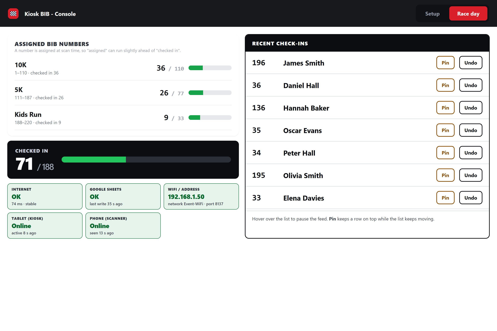

## How it works

1. The organizer pastes a Google Sheets link into the operator console on the laptop.
2. Tablets and phones join the same WiFi and open the kiosk by scanning a QR code on the console.
3. Each runner identifies themselves by QR code, PIN or name, then confirms it's them.
4. The kiosk shows and speaks their bib number, and the Sheet is updated in the background.

## For the runner

Three ways to identify, chosen per tablet: the tablet's camera, a USB barcode scanner, or a PIN pad. Runners who forget their PIN can search by name.

| Welcome | PIN entry |
| --- | --- |
| 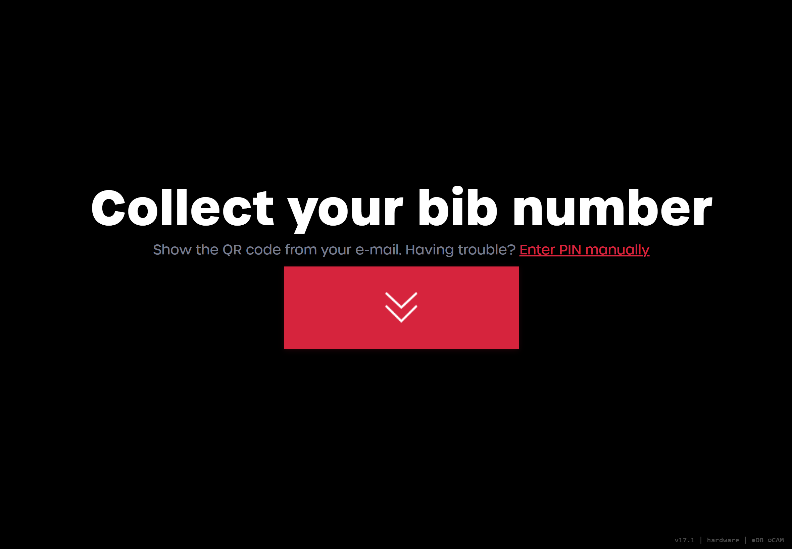 | 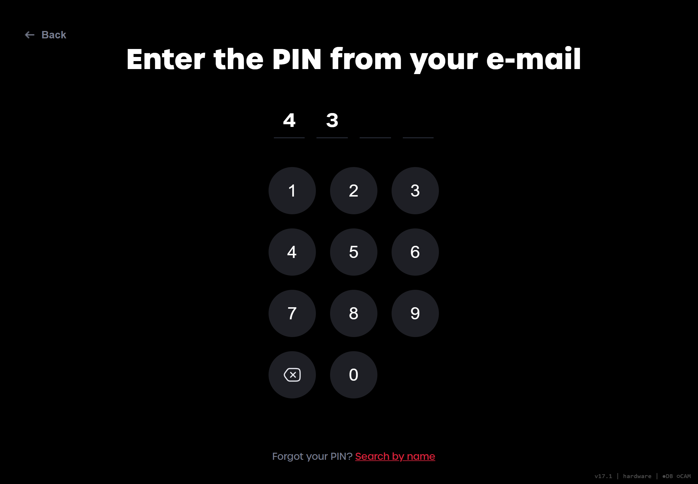 |

| Confirm identity | Number assigned |
| --- | --- |
| 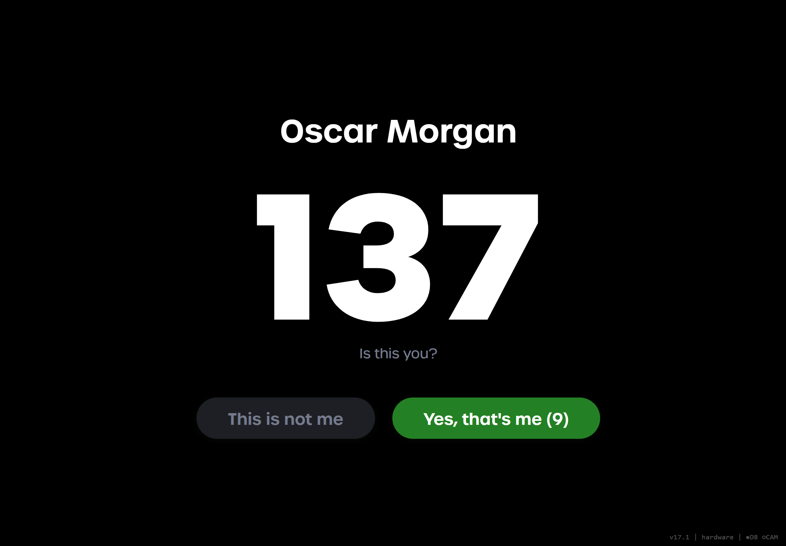 | 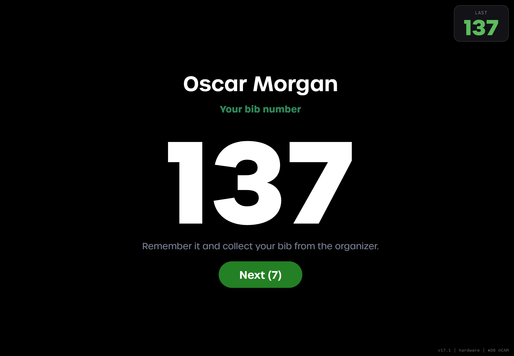 |

## For the marshal

Any phone becomes a mobile scanner, which is useful for clearing a queue away from the fixed tablets.

  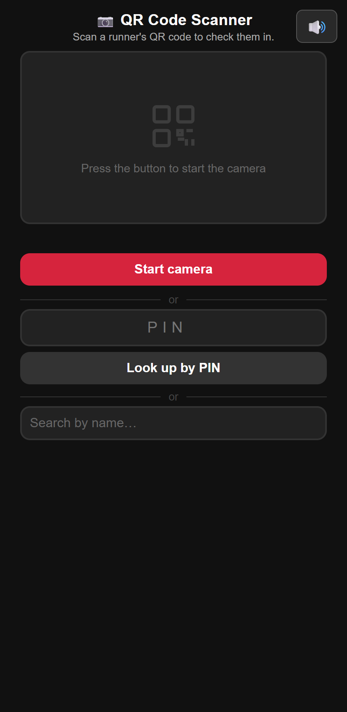
  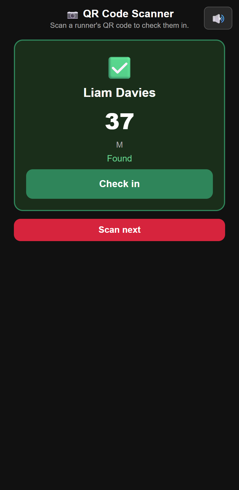

## For the operator

**Connection and devices.** Load the spreadsheet, choose the default kiosk mode and pair devices by QR code.

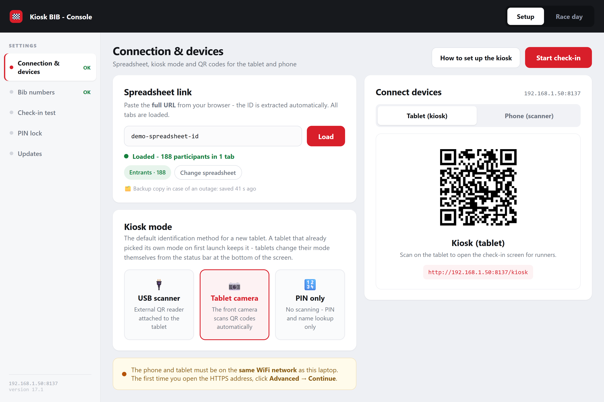

**Bib numbers.** Use numbers already in the spreadsheet, or define a range per course and let the kiosk assign the lowest free number on arrival. Rolling backups can restore numbers if someone damages the sheet mid-race.

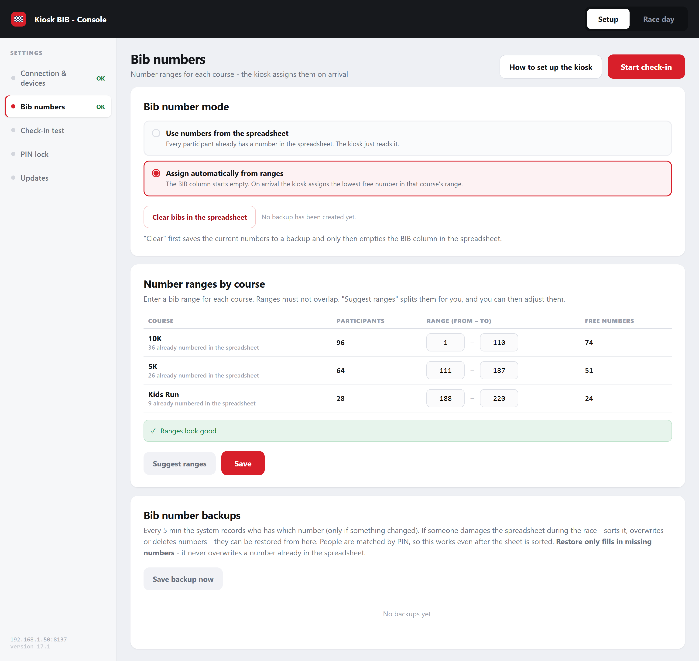

**Pre-race test.** Picks a random sample of real participants and runs them through the real devices and the real spreadsheet, which proves the whole chain works. Ending the test reverts every row it touched.

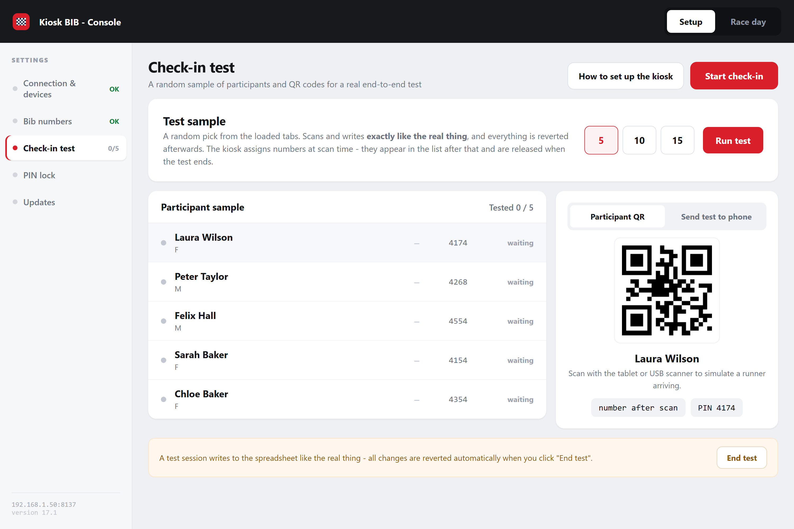

**Updates without a reinstall.** Small fixes ship as a patch of around 100 KB, by e-mail or USB. Each file is whitelisted and checksummed, the originals are backed up first, and updates are blocked while a race looks live unless the operator explicitly overrides it.

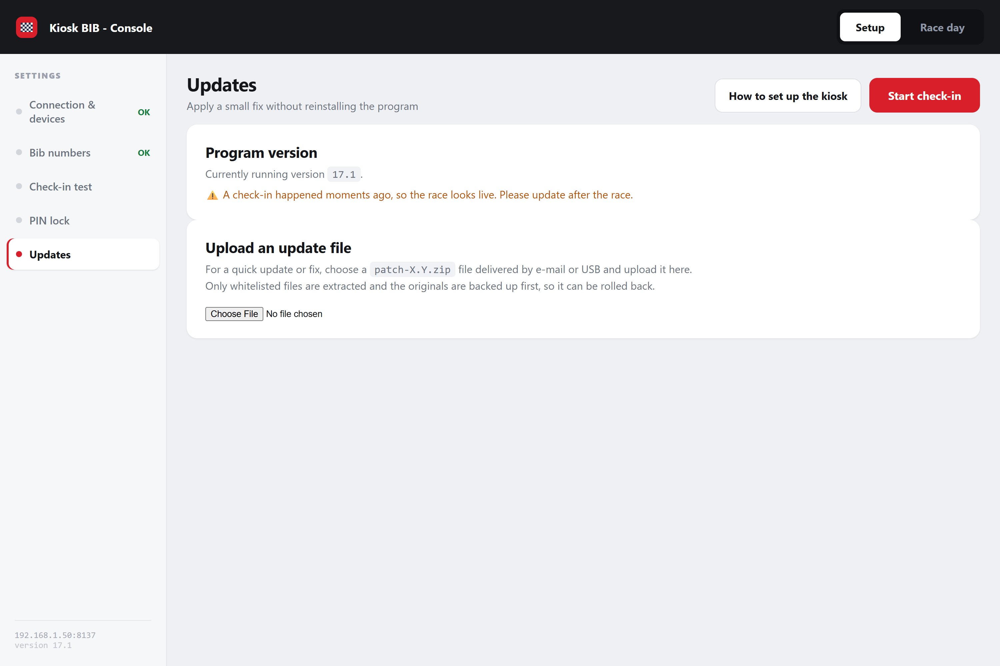

## Built for race morning

Venues have poor connectivity and nobody has time to debug, so most of the engineering went into what happens when things go wrong.

- **Keeps working offline.** After one successful load, the participant list is cached locally. If the sheet becomes unreachable, check-ins continue, queue on disk and sync automatically when the connection returns.
- **Protects pending check-ins.** Writes happen in the background so the kiosk stays instant, and a reload that hasn't caught up yet can't overwrite a check-in still on its way to the sheet.
- **Handles messy spreadsheets.** Column names are matched regardless of case or spacing. Unrelated tabs are ignored, stray spaces can't break a lookup, and when two people share a PIN the kiosk asks which one is arriving.
- **Live visibility.** The dashboard shows internet, spreadsheet writes and each device's state, with a live feed where any check-in can be undone.
- **Locked-down kiosk.** Tablets run fullscreen with back, refresh and developer shortcuts blocked.
- **Simple to hand over.** It ships as a packaged Windows program that opens its own firewall port and browser window, so the organizer doesn't need to install Python or configure a server.

## Technology

| Area | Stack |
| --- | --- |
| Backend | Python, FastAPI, Uvicorn |
| Data | Google Sheets API, local JSON cache and CSV queue |
| Frontend | Plain HTML, CSS and JavaScript, with no framework or build step |
| Scanning | Native BarcodeDetector with a jsQR fallback |
| Speech | Web Speech API, on each device |
| Delivery | PyInstaller Windows build, GitHub Actions |
| Quality | 29-suite regression harness |

## Source code

The source code is private, as this system runs a live client deployment. This repository only documents what was built.
